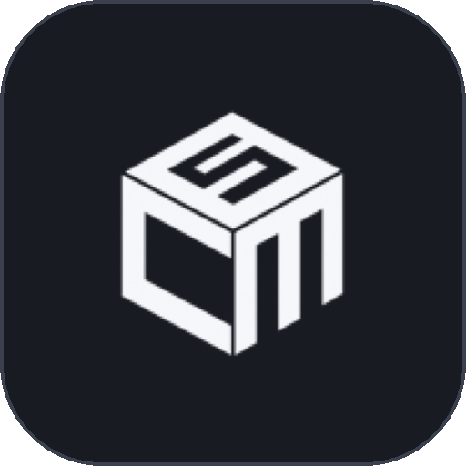
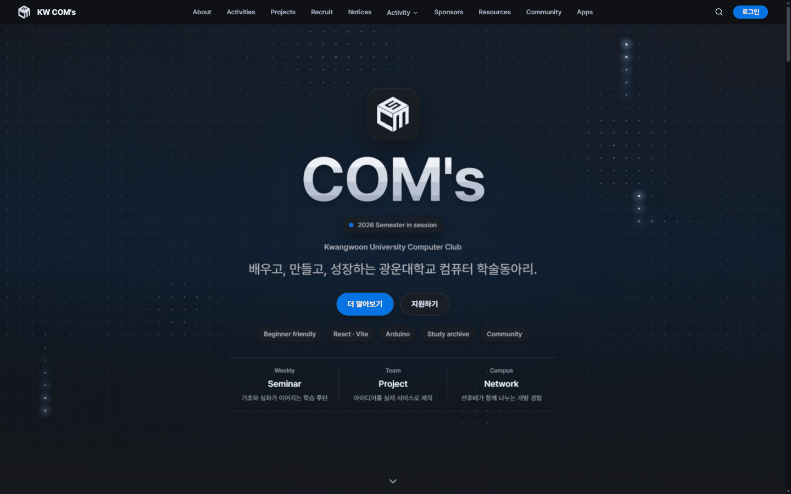
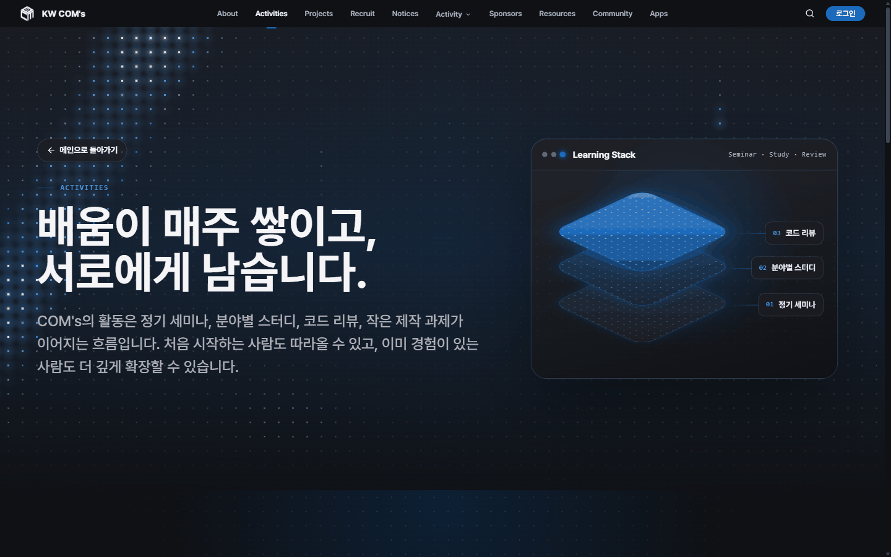
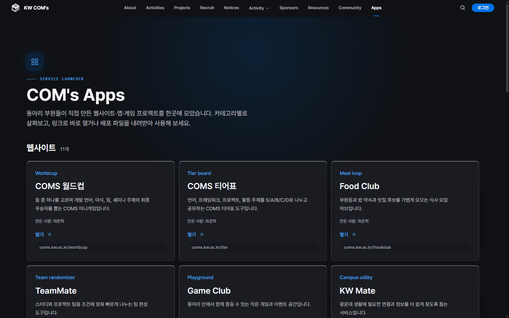
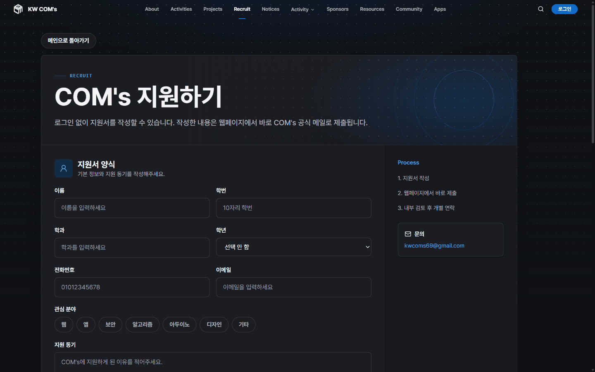
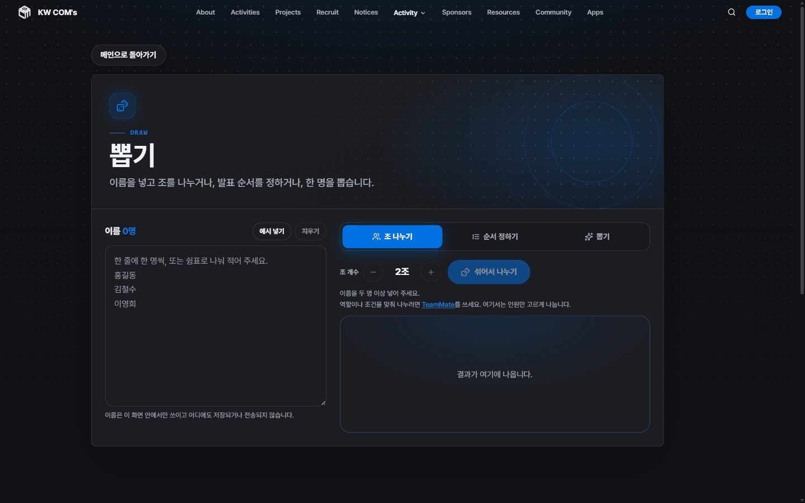
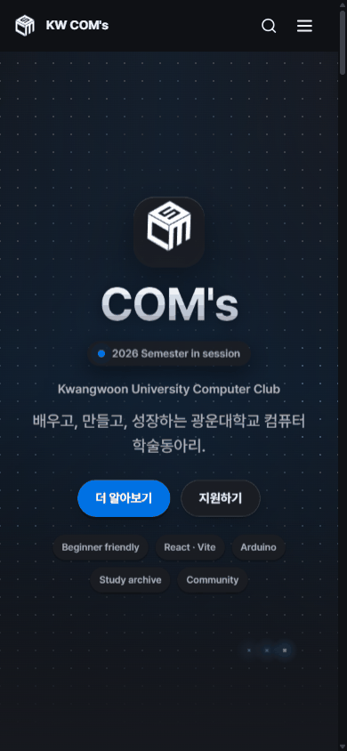
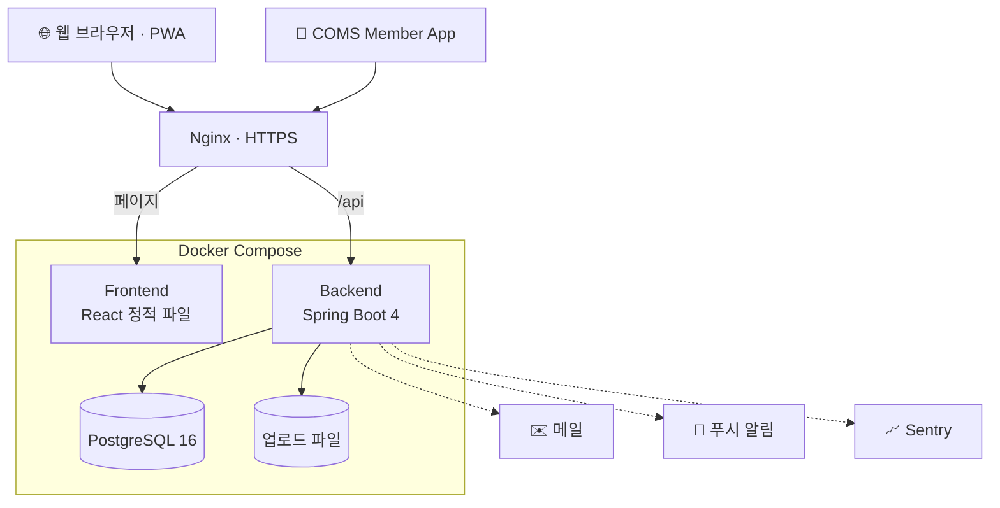
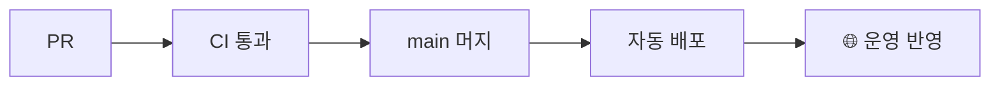

<div align="center">

<a href="https://coms.kw.ac.kr">
  
</a>

# KW COM's

**배우고, 만들고, 성장하는 광운대학교 중앙 컴퓨터 학술동아리 COM's의 공식 웹사이트**

동아리를 소개하는 홈페이지에서 시작해, 지금은 모집부터 공지·커뮤니티·출석·일정 조율·운영까지<br/>
COM's의 한 학기를 통째로 굴리는 동아리 플랫폼이 되었습니다.

<a href="https://coms.kw.ac.kr"></a>
<a href="https://github.com/kw-coms/coms-website/actions/workflows/ci.yml"></a>
<a href="https://coms.kw.ac.kr/recruit"></a>

<a href="https://coms.kw.ac.kr">웹사이트</a> ·
<a href="https://coms.kw.ac.kr/apps">COM's Apps</a> ·
<a href="https://coms.kw.ac.kr/recruit">지원하기</a> ·
<a href="https://www.instagram.com/kw_coms">Instagram</a> ·
<a href="https://www.youtube.com/@kw_coms">YouTube</a>

<br/><br/>



</div>

<br/>

## 📌 한눈에 보기

COM's는 광운대학교 학생들이 컴퓨터와 소프트웨어를 함께 공부하고, 그 배움을 실제 프로젝트로 연결하는 중앙 컴퓨터 학술동아리입니다.
이 저장소는 그 동아리가 **실제로 매일 쓰는 웹사이트**입니다. 처음 오는 사람에게는 동아리를 소개하고, 부원에게는 활동 도구가 되고, 운영진에게는 관리 콘솔이 됩니다.

<div align="center">

| 🧑‍💻 커밋 | 🔀 머지된 PR | 🖥️ 화면 | 🔌 API | 🗄️ DB 마이그레이션 | 🧩 부원 프로젝트 |
| :---: | :---: | :---: | :---: | :---: | :---: |
| **785** | **466** | **30+** | **232** | **97** | **16** |

<sub>2026년 5월 첫 커밋부터 지금까지 운영하면서 계속 고쳐 온 기록입니다.</sub>

</div>

<br/>

## ✨ 이런 걸 할 수 있어요

### 👋 처음 오신 분 — 로그인 없이

| | 기능 | 설명 |
| :---: | --- | --- |
| 🏠 | **동아리 소개** | 동아리의 정체성, 정기 세미나·스터디·코드 리뷰 활동, 팀 프로젝트를 소개합니다. |
| 📝 | **온라인 지원** | 로그인 없이 지원서를 제출하고, 학번과 이름으로 지원 진행 상황을 확인합니다. |
| 🧩 | **COM's Apps** | 부원들이 직접 만든 웹사이트·앱·게임 16개를 한곳에서 열어 볼 수 있습니다. |
| 💛 | **후원자** | 동아리를 후원해 주신 분들을 등급별로 소개합니다. |
| 🎲 | **뽑기** | 조 나누기, 발표 순서 정하기, 한 명 뽑기. 입력한 이름은 브라우저 밖으로 나가지 않습니다. |

### 🙋 부원 — 동아리 생활에 필요한 도구

| | 기능 | 설명 |
| :---: | --- | --- |
| 📢 | **공지사항** | 중요한 공지는 상단에 고정하고, 공지마다 추천·비추천으로 반응할 수 있습니다. |
| 💬 | **커뮤니티** | 이미지·파일·링크 임베드·투표·코드 블록을 넣을 수 있는 블록 에디터, 댓글, 스크랩, 신고, 회원 프로필을 지원합니다. |
| 📂 | **자료실** | 세미나 자료와 강의 파일을 올리고 내려받습니다. 관련 파일은 한 제목 아래 묶어서 관리합니다. |
| 🗓️ | **일정 캘린더** | 매주 반복되는 정기 모임과 단발 일정을 한 달 단위로 보고, `.ics`로 내 캘린더에 추가합니다. |
| 📒 | **활동 기록** | 세미나와 스터디에서 한 일을 카테고리별로 남겨, 다음 기수가 참고할 수 있게 합니다. |
| ⏰ | **일정 조율** | 각자 가능한 시간을 칠하면 모두가 되는 시간이 보입니다. 스터디나 회의 시간을 정할 때 씁니다. |
| 🙌 | **모임 신청** | 스터디원 모집, MT, 회식처럼 사람을 모을 일이 있을 때 모임을 열고 이름을 올립니다. |
| ✅ | **출석 체크** | 세미나 화면에 뜬 네 자리 코드를 입력하면 출석이 기록되고, 내 출석 기록이 쌓입니다. |
| 🏆 | **이벤트** | 회지 글과 작품을 등록하고, 인기투표를 하고, 참석 여부를 남깁니다. |
| 🔔 | **알림** | 새 공지와 댓글을 사이트 알림과 웹 푸시로 받습니다. 홈 화면에 설치하면 앱처럼 쓸 수 있습니다(PWA). |
| 🎨 | **나만의 화면** | 다크·라이트 테마와 사이트 글꼴을 원하는 대로 바꿉니다. |

### 🛠️ 운영진 — 운영 패널

동아리 운영에 필요한 일을 17개 탭의 운영 패널에서 처리합니다.

- **회원** — 회원·권한 관리, 차단 관리, 가입 가능 명부(CSV 가져오기·내보내기)
- **모집** — 지원서 검토와 처리 상태 관리, 처리 대기 지원 알림
- **콘텐츠** — 활동, COM's Apps, 후원자, 사이트 문구, 글꼴 관리
- **커뮤니티** — 신고 처리, 삭제된 글 보관함
- **점검** — 운영 요약과 방문 분석, 감사 로그(CSV 내보내기), 화면 점검

<br/>

## 📸 둘러보기

<table>
  <tr>
    <td width="50%"><p align="center"><b>활동 소개</b></p></td>
    <td width="50%"><p align="center"><b>COM's Apps</b></p></td>
  </tr>
  <tr>
    <td width="50%"><p align="center"><b>온라인 지원</b></p></td>
    <td width="50%"><p align="center"><b>뽑기 도구</b></p></td>
  </tr>
</table>

<details>
<summary><b>📱 모바일 화면 보기</b></summary>
<br/>
<p align="center"></p>
</details>

<br/>

## 🧩 COM's Apps — 부원들이 만든 것들

웹사이트의 [Apps](https://coms.kw.ac.kr/apps) 페이지는 부원들이 만든 프로젝트를 모아 둔 런처입니다. 지금 올라와 있는 프로젝트는 다음과 같습니다.

| 분류 | 프로젝트 | 한 줄 소개 |
| --- | --- | --- |
| 🌐 웹 | [COMS 월드컵](https://coms.kw.ac.kr/worldcup/) | 개발 언어·야식·밈·세미나 주제의 최종 우승자를 뽑는 미니게임 |
| 🌐 웹 | [COMS 티어표](https://coms.kw.ac.kr/tier/) | 언어·프레임워크·활동 주제를 S~D 티어로 나누고 공유 |
| 🌐 웹 | [Food Club](https://coms.kw.ac.kr/foodclub/) | 밥 약속과 맛집 후보를 모으는 식사 모임 허브 |
| 🌐 웹 | [TeamMate](https://coms.kw.ac.kr/team-randomizer/) | 역할과 조건에 맞춰 스터디·프로젝트 팀을 나누는 도구 |
| 🌐 웹 | [Game Club](https://coms.kw.ac.kr/gameclub/) | 동아리 안에서 함께 즐기는 작은 게임과 이벤트 공간 |
| 🌐 웹 | [KW Mate](http://kwmate.com/) | 광운대 생활에 필요한 연결과 정보를 찾도록 돕는 서비스 |
| 🌐 웹 | [Daily Coding](https://dailycoding-final.com/) | 매일 코딩 문제와 기록으로 학습 루틴을 만드는 공간 |
| 🌐 웹 | [KW Algorithm Lab](https://choijunhuk.github.io/kw-algorithm-lab/) | 알고리즘 실행 과정을 단계별로 보고 비교하는 학습 도구 |
| 🛠️ 개발 도구 | [BugSnap](https://coms.kw.ac.kr/BugSnap/) | 오류 스크린샷에서 텍스트를 뽑아 GitHub Issue 버그 리포트로 정리 |
| 🛠️ 개발 도구 | [LogDoctor](https://coms.kw.ac.kr/LogDoctor/) | 서버 에러 로그로 원인 후보와 해결 절차를 정리 |
| 🛠️ 개발 도구 | [PRDoctor](https://coms.kw.ac.kr/PRDoctor) | GitHub PR의 변경 요약, 위험도, 테스트 목록, 리뷰 코멘트 생성 |
| 📱 앱 | [COMS Member App](https://github.com/choijunhuk/coms-member-app) | 공지·커뮤니티·활동 기록·알림을 보는 회원 전용 모바일 앱 |
| 📱 앱 | [Rusty Alarm](https://github.com/choijunhuk/rusty-alarm) | Rust로 만든 알람 앱 |
| 🎮 게임 | [회로의 봄](https://choijunhuk.github.io/campus-romance/) | 캠퍼스 연애 시뮬레이터 비주얼 노벨 |
| 🎮 게임 | [debug-till-dawn](https://choijunhuk.github.io/debug-till-dawn/) | 프로그래밍 테마의 뱀파이어 서바이버류 로그라이크 |
| 🎮 게임 | [indie-studio-idle](https://choijunhuk.github.io/indie-studio-idle/) | 인디 게임 스튜디오를 키우는 방치형 웹게임 |

<sub>목록은 운영 패널에서 관리하며, 최신 목록은 웹사이트에서 확인할 수 있습니다.</sub>

<br/>

## 🏗️ 어떻게 동작하나요



서버 앞단의 Nginx가 HTTPS를 처리하고, 화면은 프론트엔드 컨테이너로, `/api` 요청은 백엔드로 보냅니다. 백엔드는 메일(SMTP), 푸시 알림(FCM·Web Push)을 보내고, 프론트엔드와 백엔드 오류는 Sentry로 모입니다.

**배포 흐름** — PR을 올리면 CI가 백엔드 테스트, 프론트엔드 타입 검사·린트·단위 테스트, 전체 스택 빌드를 돌립니다. `main`에 머지되어 CI가 통과하면 GitHub Actions가 서버에 접속해 Docker Compose로 새 버전을 띄우고 헬스 체크까지 확인합니다.



<br/>

## 🧰 기술 스택

| 영역 | 사용 기술 |
| --- | --- |
| **Frontend** |         |
| **Backend** |      |
| **Database** |   -1E5A96?style=flat-square) |
| **Infra** |      |
| **Test** |    |

<br/>

## 🛡️ 신경 쓴 부분

실제 회원 정보를 다루는 서비스라서, 기능만큼 안전하고 오래 운영할 수 있는 구조에 공을 들였습니다.

- **🔐 인증과 개인정보**
  - 로그인 토큰은 JavaScript가 읽을 수 없는 HttpOnly 쿠키에 담습니다.
  - 리프레시 토큰은 쓸 때마다 새로 바꿉니다. 이미 쓴 토큰이 다시 들어오면 탈취로 보고 그 기기의 로그인을 끊습니다.
  - 비밀번호는 BCrypt로 해시해서 저장합니다.
  - 동아리 명부에 있는 학생만 이메일 인증을 거쳐 가입할 수 있습니다.
  - 로그인 응답 시간을 맞추고 비밀번호 재설정 응답을 통일해, 어떤 계정이 있는지 알아낼 수 없게 합니다.
  - 로그인과 지원 조회에는 요청 횟수 제한을 둡니다.
  - 서버는 JWT 비밀키가 기본값이거나 너무 짧으면 아예 시작하지 않습니다.
- **🧱 웹 보안**
  - CSP로 외부 스크립트, `<object>` 삽입, 다른 사이트의 iframe 삽입을 막습니다.
  - 게시글 HTML은 화면에 그리는 모든 곳에서 DOMPurify 허용 목록을 거칩니다.
  - 쿠키 인증에 더해 Origin·Referer를 정확히 대조해 CSRF를 막습니다.
  - 링크 미리보기는 내부망 접근(SSRF)을 막기 위해 확인한 IP로만 연결하고, 리다이렉트마다 다시 검사합니다.
  - 업로드 파일은 확장자와 실제 내용이 다른 파일을 걸러냅니다.
  - JPEG·PNG 사진은 위치 정보(EXIF)를 지운 뒤 저장하고, 압축 폭탄 이미지는 차단합니다.
  - DB와 내부 서비스는 외부에 노출하지 않습니다.
- **✅ 테스트**
  - 백엔드 테스트 671개(90개 클래스)는 CI에서 실제 PostgreSQL로 모든 마이그레이션을 적용한 뒤 돌아갑니다.
  - 프론트엔드 단위 테스트는 52개 파일입니다.
  - Playwright E2E 111개는 주요 화면, 실제 백엔드 로그인, 커뮤니티 흐름을 확인합니다.
  - axe로 접근성을, 스크린샷 비교로 화면 깨짐을 함께 검사합니다.
- **⚡ 성능**
  - 모든 페이지를 필요할 때 불러옵니다.
  - 에디터·코드 하이라이터·Sentry처럼 무거운 모듈은 뒤로 미뤄, 첫 화면은 약 200kB(gzip)로 뜹니다.
- **🔁 CI/CD**
  - PR마다 테스트를 돌리고, `main`에서 CI가 통과한 커밋만 배포합니다.
  - OpenAPI 명세와 코드가 어긋나면 CI가 잡아냅니다.
  - OWASP Dependency-Check, CodeQL, 시크릿 스캔이 정기적으로 돌아갑니다.
- **📈 운영**
  - Sentry로 프론트엔드와 백엔드 오류를 수집합니다.
  - 헬스 체크 엔드포인트가 있습니다.
  - 운영 사이트를 대상으로 하는 스모크 테스트 스크립트가 있습니다.
  - 운영 패널에 감사 로그를 남깁니다.

<br/>

## 👥 만든 사람들

COM's 부원들이 함께 만들고 운영합니다.

<a href="https://github.com/kw-coms/coms-website/graphs/contributors">
  
</a>

<br/>

## 🤝 개발에 참여하기

```bash
git clone https://github.com/kw-coms/coms-website.git
cd coms-website
npm ci && npm run dev          # 프론트엔드 → http://localhost:3000
# 백엔드는 backend/ 에서 ./gradlew bootRun (dev 프로필, JDK 21)
```

환경 변수, 테스트, Docker 실행, 배포, 운영 메모는 **[개발 가이드](docs/DEVELOPMENT.md)**에 정리되어 있습니다.

<br/>

## 📬 연락처

<div align="center">

<a href="https://www.instagram.com/kw_coms"></a>
<a href="https://www.youtube.com/@kw_coms"></a>
<a href="mailto:kwcoms69@gmail.com"></a>
<a href="https://github.com/kw-coms"></a>

<br/><br/>

<sub>© KW COM's · 광운대학교 중앙 컴퓨터 학술동아리</sub>

</div>
